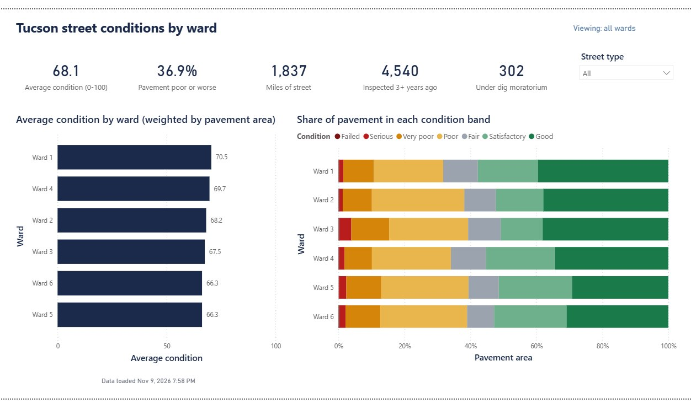
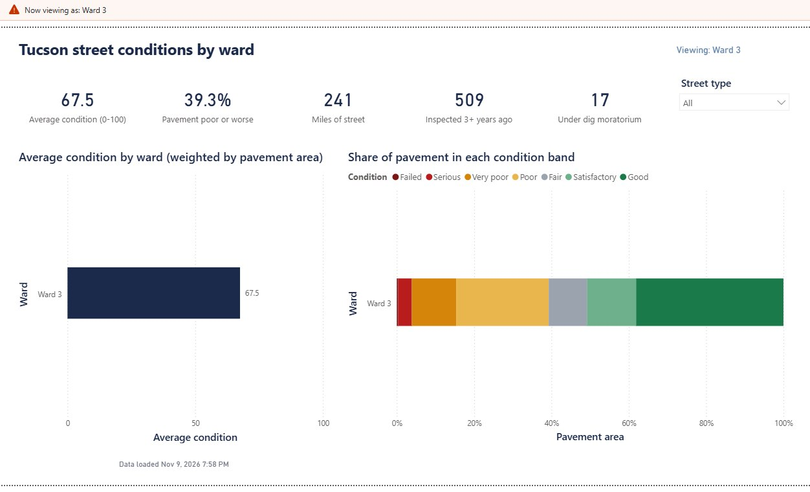
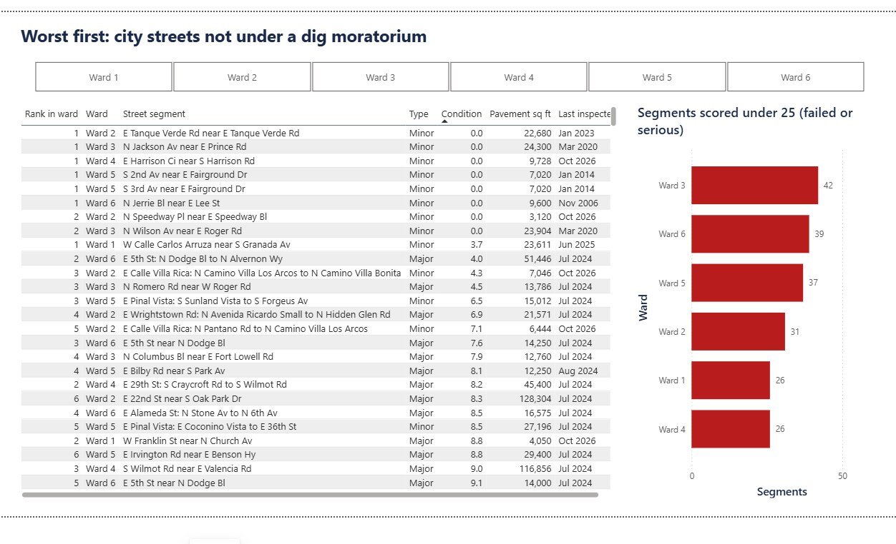
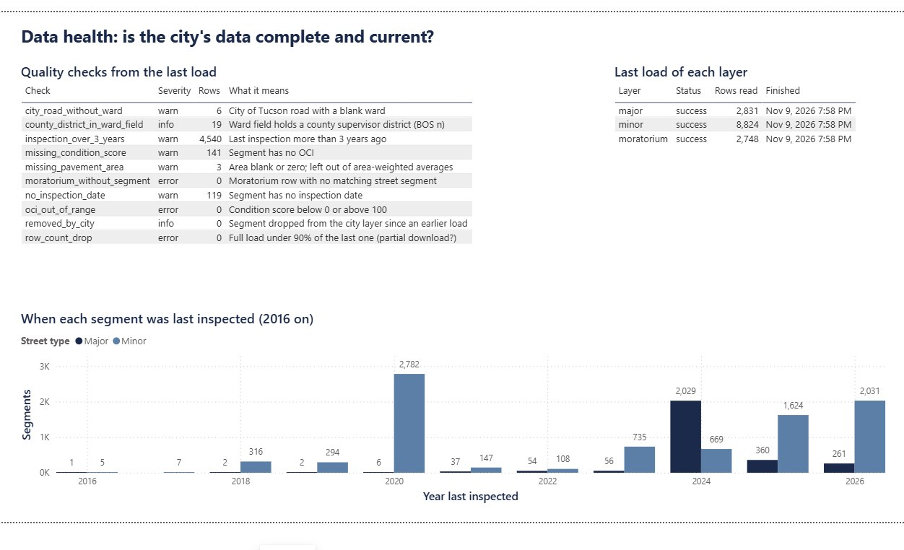
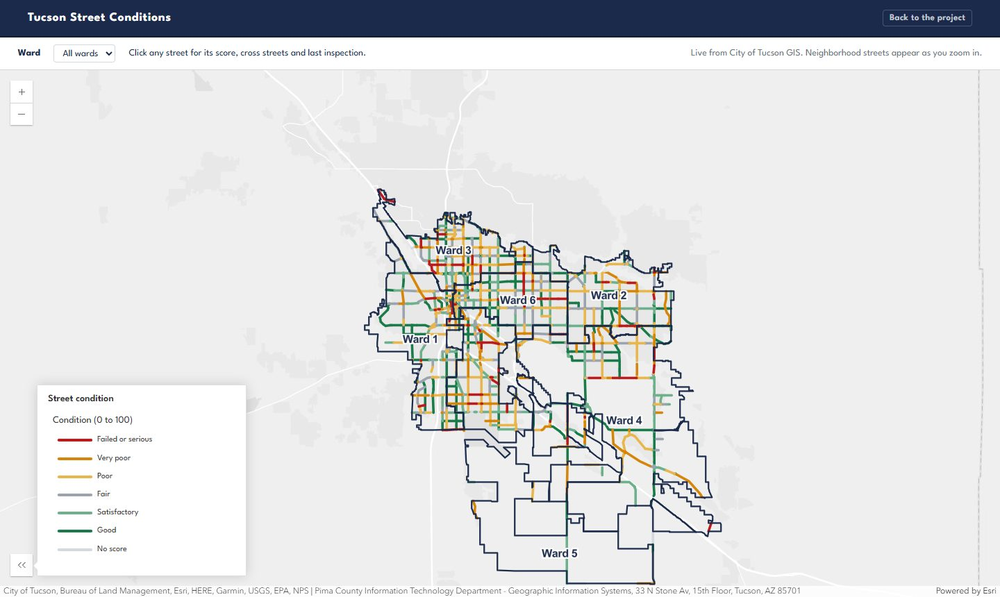
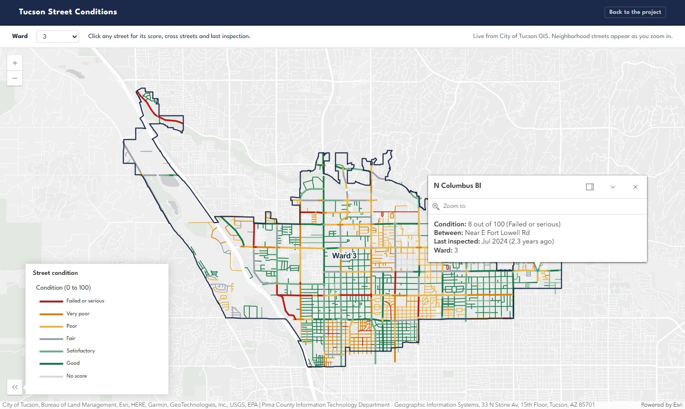

# Tucson Street Conditions

A working data pipeline and report on the City of Tucson's own street condition data: **PowerShell pulls the city's
public ArcGIS layers every night, SQL Server stores and checks them, and a Power BI report shows each ward office only
its own streets.** Built the way a city IT or GIS team would run it, with logs, data quality checks, tests and a runbook.

All data is public, from the City of Tucson's ArcGIS services. Nothing here is invented.

## What it answers
| Who | Question | Where |
|---|---|---|
| Ward council office | How are my ward's streets, and which are worst? | Power BI, ward-limited by row-level security |
| Pavement program staff | Which segments are worst first, skipping ones just repaved? | `rpt.v_worst_first`, report page 2 |
| Utility crew, permit desk | Can we cut into this street, or is it under the 5-year moratorium? | `rpt.v_dig_check` |
| GIS / data team | Is the city's data complete and current? | `dq.check_result`, report page 3 |

## Findings (data as of 2026-11-09)
| | |
|---|---|
| Street network | 11,655 segments, 1,837 miles |
| Average condition, weighted by pavement area | 68.1 of 100 (major streets 64.1, neighborhood streets 70.5) |
| Pavement area scored below 55 (poor or worse) | 36.9% |
| Segments last inspected over 3 years ago | 4,540, of which 2,782 are neighborhood streets last scored in 2020 |
| Segments with no score / no inspection date | 141 / 119 |
| Ward field problems | 19 county supervisor districts in the ward field, 6 city roads with no ward |
| Major street segments under a dig moratorium | 302, the last ending 2031-09-28 |

Full write-up: [docs/data-findings.md](docs/data-findings.md).

## How it works
```
City of Tucson ArcGIS REST (3 public layers)
   |  etl/Load-StreetData.ps1   pages of 1,000, retry with backoff, full or incremental (last_edited_date)
   v
stg.*          raw rows, bulk copied (SqlBulkCopy)
   |  etl.usp_merge_*   clean (wards, placeholder dates), hash, MERGE, record score changes
   v
core.*         one row per segment, keyed on the city's Cartegraph asset ID; condition_history; moratorium
   |  dq.usp_run_checks  10 checks, 'error' fails the run
   v
rpt.*          star schema + ready-made views  ->  Power BI report (row-level security)
                                                   ArcGIS street map reads the city's layers live (site/map.html)
etl.run_log    one row per layer per run: rows read / new / changed / unchanged, status, error
```

| Piece | Detail |
|---|---|
| Load | Windows PowerShell 5.1, no extra modules. `Invoke-RestMethod`, `System.Data.SqlClient`, `SqlBulkCopy` |
| Incremental | Asks the city only for rows edited since the last load. A full load also flags segments the city removed |
| Idempotent | Running twice changes nothing. Each row carries a SHA-256 hash; only real changes count as updates |
| History | The city's layer holds only the latest score. Every score change the loader sees lands in `core.condition_history`, so trend builds over time |
| Data quality | Partial downloads (a full load 10%+ smaller stops before any change), out-of-range scores, orphan moratorium rows, missing scores, stale inspections, ward problems |
| Security | SQL Server row-level security: `ward_reader` users see only their wards (`sec.user_ward`), `city_wide_reader` sees all. Power BI has matching static and dynamic (`USERPRINCIPALNAME()`) roles |
| Schedule | `etl/Register-Task.ps1`: nightly incremental 2:15 AM, Sunday full 3:15 AM (Task Scheduler) |

## Run it
Needs SQL Server Express (`localhost\SQLEXPRESS`) and Windows PowerShell 5.1.
```powershell
.\etl\Install-Database.ps1                     # create or update the database (rerunnable)
.\etl\Load-StreetData.ps1                      # full load, about 20 seconds
.\etl\Load-StreetData.ps1 -Mode incremental    # only what the city edited since
Invoke-Pester .\tests                          # 16 tests; builds and drops a throwaway database
.\etl\Register-Task.ps1                        # schedule it (optional)
```

## The report and the map
| | Open it | Detail |
|---|---|---|
| Power BI report | `powerbi\Tucson Street Conditions.pbip` in Power BI Desktop. It opens empty: **Home > Refresh**, Windows credentials, OK to connect unencrypted (local only) | Three pages (ward scorecard, worst first, data health) and four roles. Written by `python powerbi\tools\build_pbip.py`; see [powerbi/BUILD.md](powerbi/BUILD.md) |
| Street map | `site\map.html` in any browser | ArcGIS Maps SDK for JavaScript on the city's live layers, Arcade condition bands, pop-ups, ward filter; see [arcgis/BUILD.md](arcgis/BUILD.md) |

| Ward scorecard | Viewed as the Ward 3 role |
|---|---|
|  |  |
| **Worst first** | **Data health** |
|  |  |
| **Street map** | **One ward, one street** |
|  |  |

View as Ward 3 shows 67.5 average, 39.3% poor or worse, 241 miles and 17 under moratorium, the same as `rpt.v_ward_summary`.

## Analyst documents
| Document | What it is |
|---|---|
| [docs/requirements.md](docs/requirements.md) | Stakeholders, scope, business and functional requirements, each traced to a test |
| [docs/user-stories.csv](docs/user-stories.csv) | Epics and user stories with acceptance criteria, ready for Jira's CSV import |
| [docs/process-maps/](docs/process-maps/) | As-is and to-be process maps (BPMN 2.0, open in bpmn.io or Camunda Modeler) |
| [docs/test-plan.md](docs/test-plan.md) | Unit, integration, regression, security and user acceptance cases |
| [docs/runbook.md](docs/runbook.md) | Schedule, logs, what each check means, common failures, adding a ward user |

## Layout
```
etl/      StreetData.psm1 (functions), Load-StreetData.ps1, Install-Database.ps1, Register-Task.ps1
sql/      01 schema, 02 merge procedures, 03 reporting views, 04 quality checks, 05 security
tests/    Pester tests: unit (shaping, retry) and integration (merge, history, checks, security)
powerbi/  Tucson Street Conditions.pbip (TMDL model + PBIR report), measures.dax, tools/build_pbip.py, BUILD.md
arcgis/   BUILD.md (how the map works, optional ArcGIS Online save)
docs/     requirements, user stories, process maps, test plan, runbook, findings
site/     the project page, map.html (street map), img/ (report and map screenshots)
```

## Sources
- Pavement Condition, Major and Minor Streets; Pavement Moratorium, Major Roads: City of Tucson GIS, ArcGIS Online.
- Wards - City of Tucson: Pima County GIS open data.
- Condition bands: ASTM D6433 pavement rating scale. The city's OCI uses the same 0 to 100 range.
- Prop 411 program and worst-first selection: City of Tucson Prop 411 Phase 1 release (content.govdelivery.com/accounts/AZTUCSON/bulletins/362edfc) and KGUN 9; 5-year cut moratorium and OCI 40 fee exemption: City of Tucson Permits and Codes. Links in [docs/requirements.md](docs/requirements.md).
